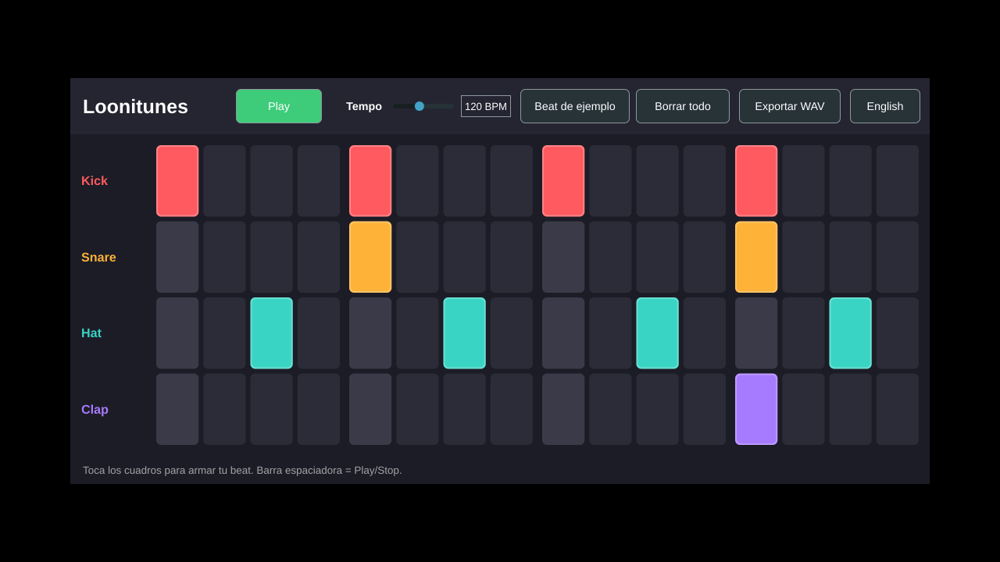

# Loonitunes

**Español** · [English](#english)

Loonitunes es un DAW gratis y open source para la gente que está empezando a producir música. La idea es juntar lo mejor de dos mundos: la Session View para lanzar clips en vivo y el Piano Roll con patrones para armar beats rápido, en un programa que corre en una laptop barata y que se entiende sin tutoriales largos.

Es parte de los proyectos libres de ROMMUSER Studio: herramientas de calidad, gratis para siempre, sin cuentas ni anuncios.



## Estado: prototipo (fase 0)

Esta primera versión ya hace esto:

- Channel Rack con 4 sonidos (Kick, Snare, Hat, Clap) y 16 pasos.
- Kit de drums propio, sintetizado en el código (libre de derechos).
- Play/Stop (también con la barra espaciadora), tempo de 60 a 200 BPM.
- Beat de ejemplo para que suene bien desde el primer clic.
- Exportar 4 compases a WAV estéreo.
- Pantalla en español o inglés.

## Lo que viene

| Fase | Qué trae |
| --- | --- |
| 1. Beat maker | Piano Roll, varios patrones, Playlist, sampler y synth básicos |
| 2. Session View + mixer | Clips y escenas, mixer con inserts y sends, cargar plugins VST3 y CLAP |
| 3. Audio y automatización | Pistas de audio con warp, automatización, exportar stems |
| 4. v1.0 | Instaladores para Windows y Mac, Modo Simple, sonidos y tutoriales |

## Descargar

Cada versión publicada tiene los archivos en [Releases](https://github.com/axelfj/loonitunes/releases). Mientras tanto, cada build de [Actions](https://github.com/axelfj/loonitunes/actions) deja un zip para Windows, Mac y Linux.

En Mac la app todavía no está firmada: la primera vez, clic derecho sobre Loonitunes y "Abrir".

## Compilar

Necesitas CMake 3.22+, un compilador C++20 y git.

```sh
git clone --recurse-submodules https://github.com/axelfj/loonitunes
cd loonitunes
cmake -S . -B build -DCMAKE_BUILD_TYPE=Release
cmake --build build --config Release
ctest --test-dir build -C Release
```

En Linux hacen falta las librerías de desarrollo de ALSA, X11 y freetype (mira `.github/workflows/build.yml`).

## Cómo está hecho

- Motor de audio: [Tracktion Engine](https://github.com/Tracktion/tracktion_engine) (GPL-3).
- Interfaz y plugins: [JUCE](https://juce.com) (GPL-3).
- `src/core`: la canción y el kit de drums, sin ventanas, probado con `tests/`.
- `src/app`: la interfaz.

## Licencia

GPL-3.0 o posterior. Puedes usarlo, estudiarlo, cambiarlo y compartirlo, siempre que lo que compartas siga siendo libre. Ver [LICENSE](LICENSE).

---

## English

Loonitunes is a free, open-source DAW for people who are just starting to make music. It brings together the best of two worlds: a Session View for launching clips live, and a Piano Roll with patterns for building beats fast, in an app that runs on a cheap laptop and makes sense without long tutorials.

It is one of ROMMUSER Studio's free projects: quality tools, free forever, no accounts or ads.

**Status:** phase 0 prototype. It has a 4-sound, 16-step Channel Rack with a built-in synthesised drum kit, Play/Stop (space bar), tempo from 60 to 200 BPM, a starter beat, 4-bar stereo WAV export, and a Spanish/English UI. See the table above for the roadmap.

**Build:** CMake 3.22+, a C++20 compiler and git; the commands are in the Spanish section above.

**Built with** Tracktion Engine and JUCE, both GPL-3. **License:** GPL-3.0-or-later, see [LICENSE](LICENSE).
